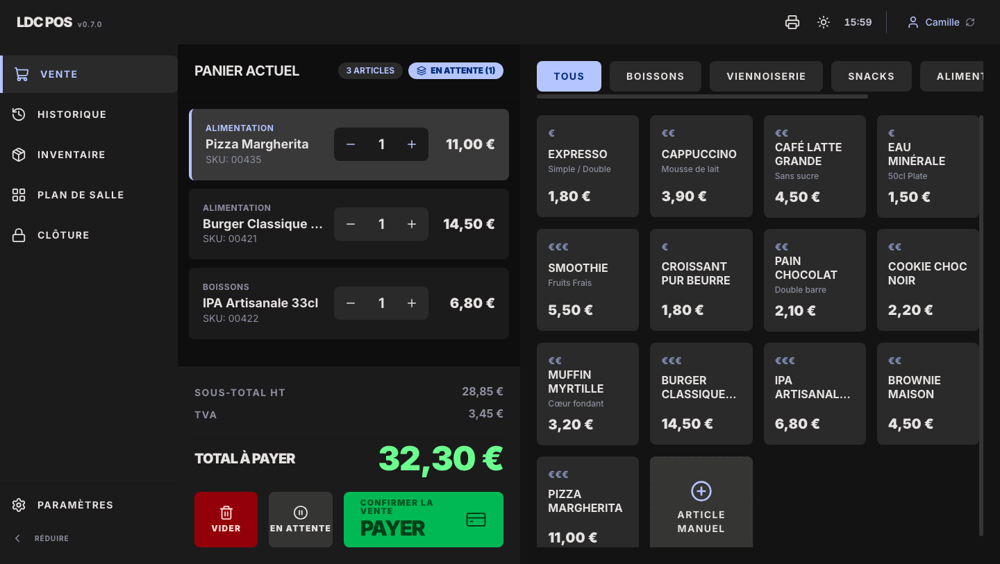
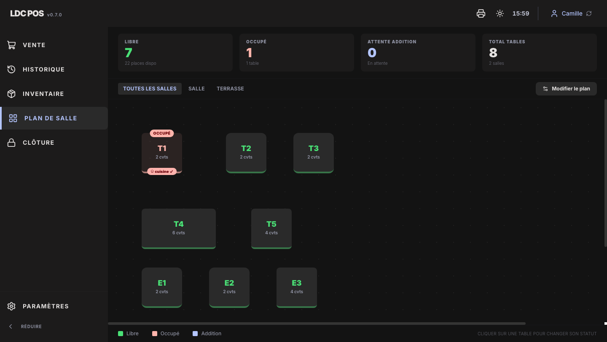
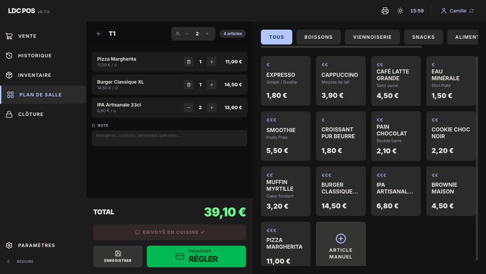
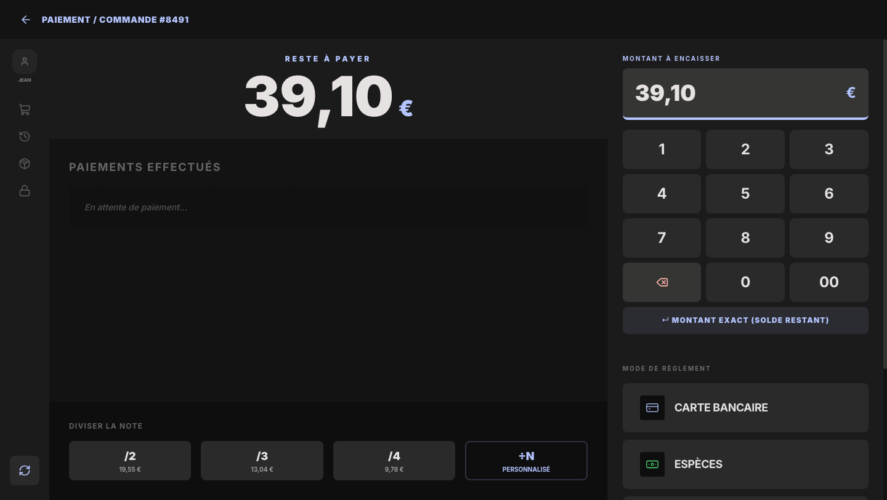
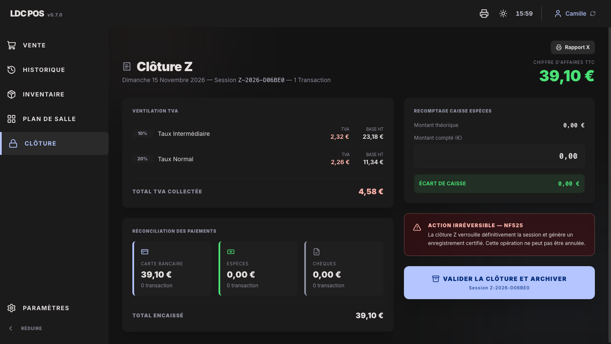

# LDC — Logiciel de caisse libre

[](https://github.com/aizo-groove/ldc/actions/workflows/ci.yml)
[](https://github.com/aizo-groove/ldc/releases/latest)
[](LICENSE)

Logiciel de caisse gratuit et libre pour les petits commerces français : cafés, restaurants, commerces de proximité. Application de bureau (macOS, Windows) qui fonctionne **entièrement hors ligne**, avec les données stockées localement chez le commerçant.

**[Essayer la démo en ligne](https://ldc-rust.vercel.app)** · **[Télécharger](https://github.com/aizo-groove/ldc/releases/latest)** · [Site du projet](https://ldc-web.vercel.app)



> **Statut : bêta.** LDC implémente les mécanismes de sécurisation demandés par la norme NF525, mais **n'est pas certifié** par un organisme accrédité. Voir [Conformité NF525](#conformité-nf525).

---

## Pourquoi LDC

Les logiciels de caisse du marché coûtent souvent 50 à 200 € par mois, dépendent d'une connexion internet et gardent les données du commerçant sur leurs serveurs. Pour un petit commerce, c'est une charge fixe de plus et une dépendance.

LDC part du principe inverse :
- **Gratuit et libre** (licence MIT), sans fonctionnalité réservée à une version payante.
- **Hors ligne d'abord** : l'encaissement ne dépend jamais du réseau.
- **Données locales** : une base SQLite sur le poste du commerçant, qu'il peut sauvegarder et exporter.
- **Pensé pour la France** : TVA par taux, titres-restaurant, exigences NF525.

Le périmètre fonctionnel s'appuie sur une analyse terrain des logiciels existants et des besoins de commerces indépendants.

## Fonctionnalités

**Vente**
- Catalogue avec catégories, taux de TVA et suivi de stock optionnel
- Paiements CB, espèces (rendu monnaie), chèque, titre-restaurant, paiements mixtes et addition partagée
- **Notes en attente** : mettre un client de côté en un clic, le reprendre en un clic

**Restaurant**
- Plan de salle multi-salles, tables par glisser-déposer
- Tickets de table avec couverts, notes de commande et envoi en cuisine (ticket « complément » pour les ajouts)

| Plan de salle | Ticket de table |
|---|---|
|  |  |

**Clôture et conformité**
- Rapport X et clôture Z avec ventilation de la TVA et réconciliation des paiements
- Chaîne de hachage des transactions et des clôtures, grands totaux perpétuels, journal d'audit
- Duplicatas numérotés et tracés, export de l'archive fiscale

| Paiement | Clôture Z |
|---|---|
|  |  |

**Matériel et poste**
- Imprimante thermique ESC/POS en réseau (58 ou 80 mm), tiroir-caisse, douchette USB
- Écran client sur un second moniteur
- Multi-caissiers avec code PIN, profils Restaurant / Café / Commerce
- Assistant de démarrage, visite guidée, thème clair et sombre, mises à jour automatiques

## Conformité NF525

LDC implémente les mécanismes attendus d'un logiciel de caisse sécurisé :

| Exigence | Implémentation |
|---|---|
| Inaltérabilité | Chaque transaction est chaînée à la précédente par une empreinte SHA-256 ; les tables fiscales sont en ajout seul |
| Clôtures | Clôture Z chaînée aux précédentes et ancrée sur la dernière transaction de la session |
| Cumuls | Grands totaux perpétuels, jamais remis à zéro |
| Traçabilité | Journal d'audit des événements, duplicatas numérotés |
| Vérification | Contrôle de toute la chaîne en un clic, avec le premier maillon cassé signalé |
| Conservation | Export complet de l'archive fiscale (à conserver 6 ans) |

**LDC n'est pas certifié** par un organisme accrédité (LNE, Infocert). Le commerçant reste responsable de la conformité de son établissement : renseignez-vous auprès de votre expert-comptable. Clause complète : [docs/MENTIONS_LEGALES.md](docs/MENTIONS_LEGALES.md).

## Comment le projet est mené

LDC est conçu et piloté par une seule personne, avec une démarche produit et un développement réalisé par des agents IA ([Claude Code](https://claude.com/claude-code)) dans un cadre contrôlé :

- **Découpage** : chaque évolution part d'une issue au périmètre précis, limitée à une PR de taille relisible.
- **Règles explicites** pour les agents ([CLAUDE.md](CLAUDE.md)) : montants en centimes entiers, migrations en ajout seul, hors ligne d'abord, aucune donnée personnelle de client.
- **Intégration continue** : formatage, lint strict (`clippy -D warnings`), tests Rust et vérification TypeScript sur chaque PR.
- **Double relecture** : relecture automatique par un agent dédié, puis relecture et validation humaines avant chaque merge.
- **Code fiscal encadré** : toute modification de `src-tauri/src/nf525/` porte un label dédié et s'accompagne d'un test de vérification de chaîne ; la branche principale n'accepte que des PR.

## Stack technique

| Couche | Technologie |
|---|---|
| Application de bureau | [Tauri v2](https://tauri.app) (binaire natif, sans Electron) |
| Backend | Rust : chaîne fiscale, clôtures, impression ESC/POS |
| Base de données | SQLite via [sqlx](https://github.com/launchbadge/sqlx), migrations versionnées |
| Interface | React 19, TypeScript, Zustand, Tailwind CSS v4 |
| Démo web | Même interface, branchée sur un backend en mémoire quand elle tourne hors de Tauri |

Tous les montants circulent en **centimes entiers**. Détails : [docs/ARCHITECTURE.md](docs/ARCHITECTURE.md).

## Développement

Prérequis : [Rust](https://rustup.rs/) stable, [Node.js](https://nodejs.org/) 20+, et les [prérequis Tauri](https://tauri.app/start/prerequisites/) de votre système.

```bash
npm install
npm run tauri dev      # application de bureau (base isolée ldc-dev.db)
npm run dev            # interface seule dans le navigateur (mode démo)
npm run tauri build    # installeur natif dans src-tauri/target/release/bundle/
```

Vérifications lancées par la CI :

```bash
cd src-tauri && cargo fmt --check && cargo clippy -- -D warnings && cargo test
cd .. && npx tsc --noEmit
```

## Documentation

- [Guide utilisateur](docs/GUIDE_UTILISATEUR.md)
- [Architecture](docs/ARCHITECTURE.md)
- [Modèle d'attestation](docs/ATTESTATION_NF525.md)
- [Mentions légales](docs/MENTIONS_LEGALES.md)

## Licence

[MIT](LICENSE). Le logiciel est fourni « tel quel », sans garantie, y compris en matière fiscale.

## Auteur

Conçu et piloté par **Enzo Schwander**, product manager et ingénieur.
<!-- Lien LinkedIn à ajouter -->

LDC est gratuit. S'il vous rend service, vous pouvez soutenir le projet sur [Ko-fi](https://ko-fi.com/aizogroove).
